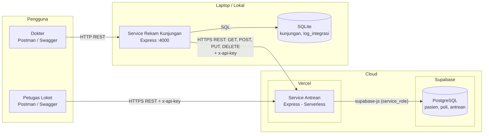
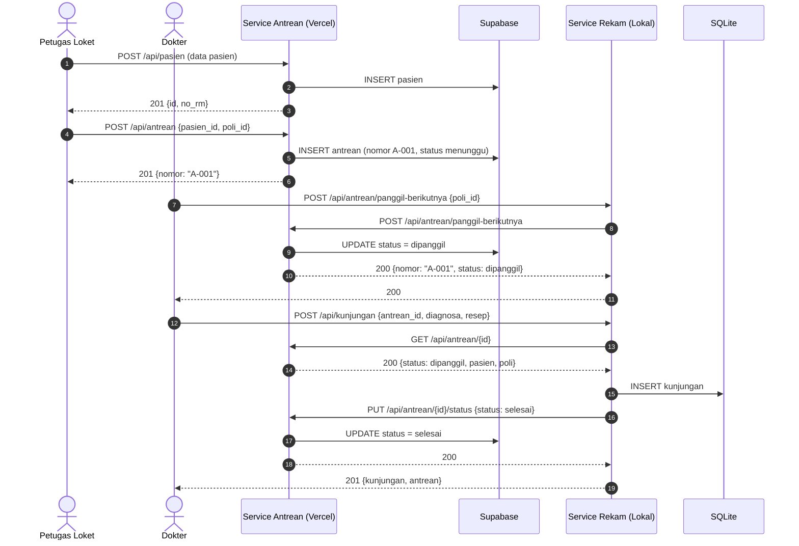
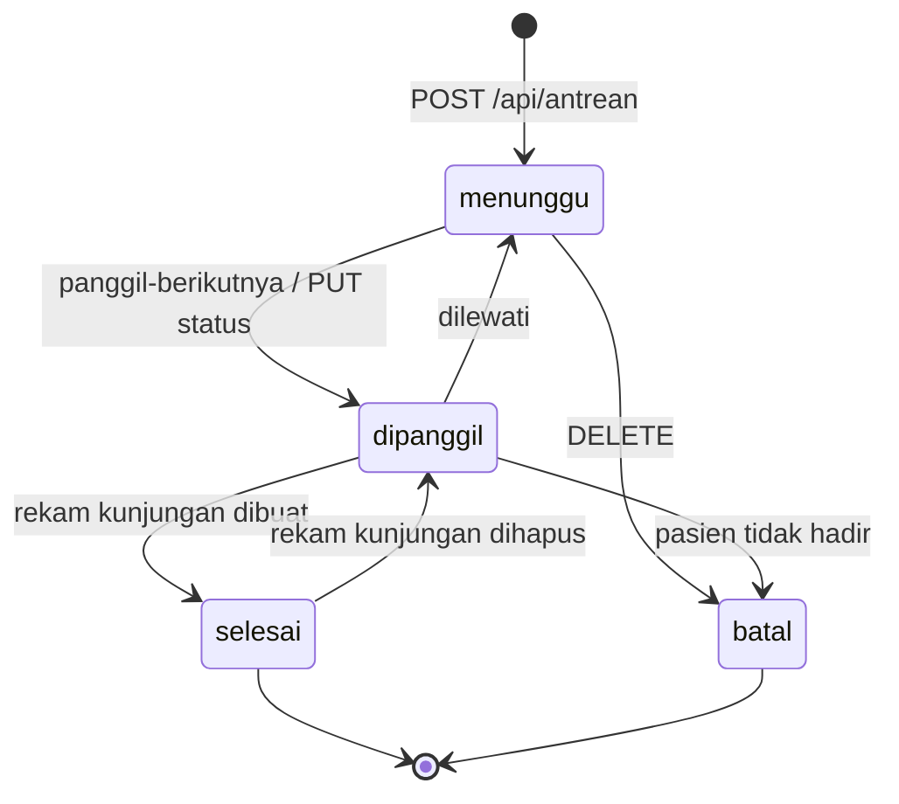
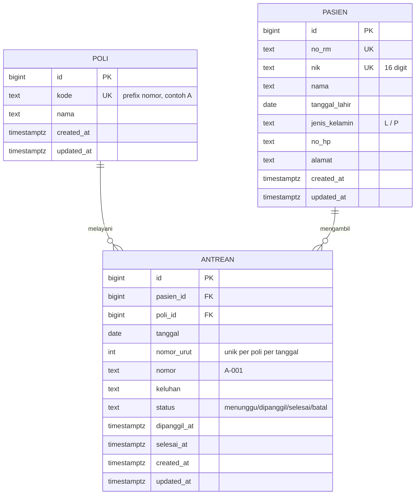
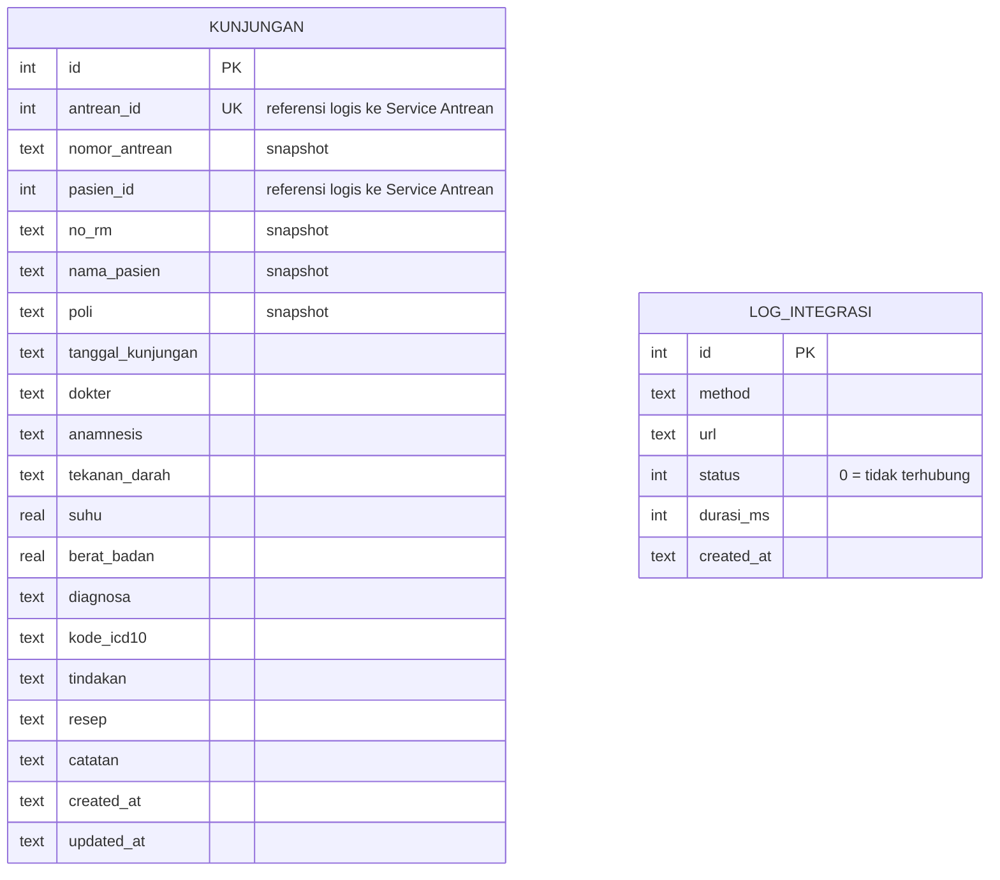

# Desain Arsitektur: Sistem Antrean & Rekam Kunjungan Klinik/Puskesmas

## 1. Gambaran Umum

Sistem terdiri dari **dua service independen** yang berkomunikasi lewat **HTTP REST API (JSON)**:

| | Service Antrean | Service Rekam Kunjungan |
|---|---|---|
| Tanggung jawab | Data pasien, poli, nomor antrean & status antrean | Rekam medis kunjungan (anamnesis, diagnosa, tindakan, resep) |
| Pengguna | Petugas pendaftaran / loket | Dokter / perawat di ruang periksa |
| Teknologi | Node.js + Express 5 | Node.js + Express 5 |
| Database | Supabase (PostgreSQL, cloud) | SQLite (file lokal, modul bawaan `node:sqlite`) |
| Deployment | **Vercel** (Serverless Function, cloud) | Lokal (`localhost:4000`) |
| Keamanan | Header `x-api-key` di semua `/api/*` | Kunci disimpan di `.env`, dikirim ke Service Antrean |
| Dokumentasi | `/docs` (Swagger UI) | `/docs` (Swagger UI) |

Kedua service sengaja memakai **database terpisah** (*database per service*): tidak ada service yang membaca database milik service lain. Semua pertukaran data lewat API.

## 2. Diagram Arsitektur



## 3. Komunikasi Antar Service

Service Rekam Kunjungan bertindak sebagai **client** bagi Service Antrean (`service-rekam/src/antreanClient.js`). Setiap request dicatat di tabel `log_integrasi` (lihat `GET /api/log-integrasi`).

| Method | Request ke Service Antrean | Dipicu oleh endpoint Service Rekam | Tujuan |
|---|---|---|---|
| GET | `/api/antrean/{id}` | `POST /api/kunjungan` | Validasi antrean ada & berstatus `dipanggil` |
| PUT | `/api/antrean/{id}/status` `{status: selesai}` | `POST /api/kunjungan` | Tandai antrean selesai setelah diperiksa |
| PUT | `/api/antrean/{id}/status` `{status: dipanggil}` | `DELETE /api/kunjungan/{id}` | Buka kembali antrean bila rekam dihapus |
| GET | `/api/antrean?poli_id=&status=` | `GET /api/antrean` | Lihat daftar antrean di ruang periksa |
| POST | `/api/antrean/panggil-berikutnya` | `POST /api/antrean/panggil-berikutnya` | Panggil pasien berikutnya |
| DELETE | `/api/antrean/{id}` | `DELETE /api/antrean/{id}` | Pasien tidak hadir, antrean dibatalkan |
| GET | `/api/pasien/{id}` | `GET /api/pasien/{id}/riwayat` | Gabungkan data diri pasien + riwayat medis |

### Penanganan kegagalan

- Service Antrean mati / timeout → Service Rekam membalas **503** (`Service Antrean tidak dapat dihubungi`).
- API key salah → **502 Bad Gateway** (masalah konfigurasi, bukan kesalahan client).
- Error 4xx lain (404, 409) dari Service Antrean diteruskan apa adanya.
- **Kompensasi:** pada `POST /api/kunjungan`, bila `PUT status selesai` gagal setelah rekam tersimpan, rekam lokal dihapus lagi agar data kedua service tetap konsisten.

## 4. Diagram Alur (Sequence) Kunjungan Pasien



## 5. Diagram Status Antrean



## 6. ERD

### Service Antrean (Supabase / PostgreSQL)



### Service Rekam Kunjungan (SQLite)



`antrean_id` dan `pasien_id` di Service Rekam adalah **referensi logis** (bukan foreign key database) karena datanya ada di service lain. Nama pasien, nomor RM, dan poli disalin sebagai *snapshot* saat kunjungan dibuat, sehingga riwayat medis tetap terbaca meski Service Antrean sedang tidak bisa dihubungi.

## 7. Struktur Folder

```
.
├── service-antrean/        # Anggota 1: deploy di Vercel
│   ├── api/index.js        # entry point Vercel
│   ├── server.js           # entry point lokal
│   ├── src/                # app, routes, db (supabase + memory)
│   ├── supabase/schema.sql # skema database
│   ├── openapi.yaml        # dokumentasi Swagger
│   └── vercel.json
├── service-rekam/          # Anggota 2: jalan lokal
│   ├── server.js
│   ├── src/                # app, routes, db SQLite, client ke service antrean
│   └── openapi.yaml
├── docs/                   # Anggota 3
│   ├── arsitektur.md       # dokumen ini
│   ├── deploy.md           # panduan Supabase + Vercel
│   ├── postman/            # koleksi Postman
│   └── laporan/            # kerangka laporan
└── tests/                  # Anggota 3: tes integrasi end-to-end
```
